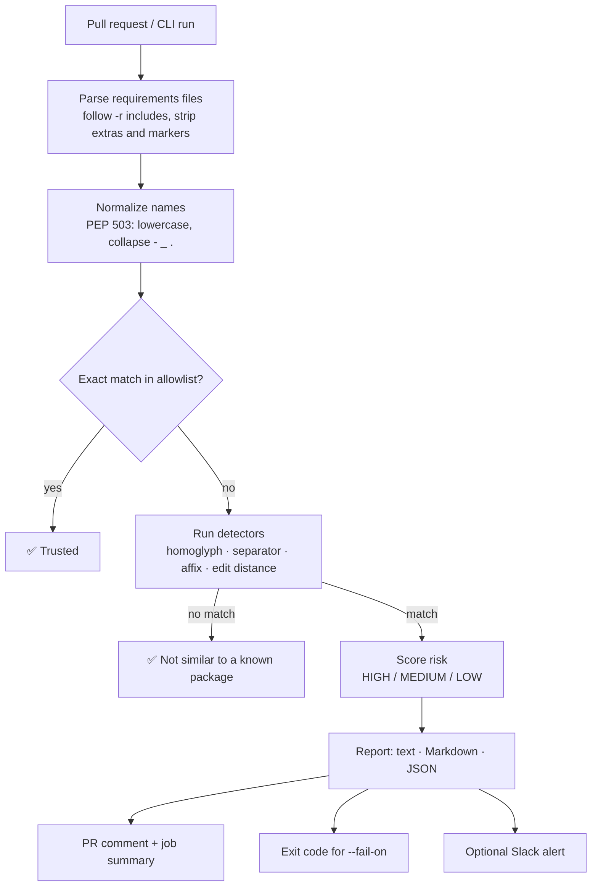

# 🛡️ typosquat-guard

[](https://github.com/sxxsalihxxs/new/actions/workflows/ci.yml)


[](LICENSE)

**Catch typosquatted and look-alike Python packages before they reach your supply chain.**

`typosquat-guard` scans `requirements.txt` files and flags packages whose names look a lot like
popular, legitimate ones, such as `reqeusts` (for `requests`), `djang0` (for `django`) or `python-requests`. It runs as a
CLI and as a GitHub Action that comments on pull requests and can fail the check.

---

## Why

Typosquatting is one of the cheapest supply-chain attacks there is. An attacker uploads
a malicious package with a name one keystroke away from a popular one and waits for someone to mistype it,
or for a reviewer to miss it in a diff. PyPI has removed hundreds of these packages, and many of them stole
credentials or environment variables as soon as they were installed.

A one-character difference is easy to miss in code review. It is easy for a machine to catch.

📄 Read the [case study](docs/case-study.md) for the full story behind the project (STAR format).

## Features

- **Five detection techniques**: edit distance with transpositions, homoglyphs, separator tricks, affixes and numeric suffixes (see [Detection](#detection))
- **Risk scoring** (`HIGH` / `MEDIUM` / `LOW`) and a pointer to the exact `file:line`
- **Understands real requirements files**: `-r` includes, extras, environment markers, inline comments, `pkg @ url`
- **Bundled allowlist** of ~130 popular PyPI packages, which you can extend with your own (including internal package names)
- **Text, Markdown and JSON reports**
- **CI-friendly exit codes** controlled by `--fail-on`
- **GitHub Action** that posts one PR comment and updates it on later pushes, plus a job summary
- **Optional Slack alert** via an incoming webhook
- **Zero runtime dependencies**, pure standard library

## Quick start

```bash
pip install git+https://github.com/sxxsalihxxs/new.git
typosquat-guard requirements.txt
```

```text
$ typosquat-guard examples/requirements-suspicious.txt
Scanned 8 packages in examples/requirements-suspicious.txt (High: 3 | Medium: 1 | Low: 0)
  [HIGH  ] reqeusts                 -> requests             1 edit away from `requests` (examples/requirements-suspicious.txt:2)
  [HIGH  ] numpi                    -> numpy                1 edit away from `numpy` (examples/requirements-suspicious.txt:4)
  [HIGH  ] djang0                   -> django               look-alike characters for `django` (examples/requirements-suspicious.txt:5)
  [MEDIUM] python-requests          -> requests             `requests` with a `python-` prefix (examples/requirements-suspicious.txt:8)
$ echo $?
1
```

## GitHub Action

Add `.github/workflows/typosquat.yml` to any repository:

```yaml
name: Typosquat Guard
on: pull_request

permissions:
  contents: read
  pull-requests: write

jobs:
  scan:
    runs-on: ubuntu-latest
    steps:
      - uses: actions/checkout@v4
      - uses: sxxsalihxxs/new@main
        with:
          files: requirements.txt requirements-dev.txt
          fail-on: high          # high | medium | low | never
          # allowlist: .github/typosquat-allowlist.txt
```

Each PR then gets one report comment, which is updated on every push:

> ## 🛡️ Typosquat Guard report
> **High: 1 | Medium: 0 | Low: 0**
>
> | Risk | Package | Looks like | Technique | Why | Location |
> |---|---|---|---|---|---|
> | 🔴 **HIGH** | `reqeusts` | `requests` | edit-distance | 1 edit away from `requests` | `requirements.txt:2` |

## How it works



## Detection

| Technique | Example | Risk |
|---|---|---|
| **Homoglyph**: look-alike characters (`0→o`, `1→l`, `5→s`, …) | `djang0` → `django` | HIGH |
| **Separator**: same letters, different `-` / `_` / `.` placement | `beautiful-soup4` → `beautifulsoup4` | HIGH |
| **Edit distance (1)**: one insertion, deletion, substitution or **swap** | `reqeusts` → `requests` | HIGH |
| **Edit distance (2)**: names of 9+ characters only | `scikit-lrn` → `scikit-learn` | MEDIUM |
| **Affix**: `python-`, `py-`, `-py`, `-lib`, `-dev`, `-official`, trailing digits | `python-requests`, `requests2` | MEDIUM |
| **Edit distance (3)**: names of 15+ characters only | `djangorestfrmwrk` → `djangorestframework` | LOW |

Edit distance is computed with *optimal string alignment*, so swapping two adjacent letters counts as one
edit. The allowed distance grows with name length (names of 4 characters or fewer: 0, 5–8: 1, 9–14: 2, 15+: 3). This keeps short,
naturally similar names such as `tox` and `nox` from being flagged.

## CLI reference

```text
typosquat-guard [FILES ...] [options]

  --allowlist PATH          extra allowlist merged with the built-in one (repeatable)
  --no-default-allowlist    use only the allowlists passed with --allowlist
  --ignore NAME             never flag this package (repeatable)
  --format {text,markdown,json}
  --out PATH                write the report to a file instead of stdout
  --fail-on {high,medium,low,never}   default: high
  --slack                   post findings to $SLACK_WEBHOOK_URL
  --version
```

**Exit codes:** `0` means no findings at or above `--fail-on`, `1` means policy violated, `2` means an input error (for example, a missing file).

### Custom allowlist

If you have internal packages, add them so that look-alikes of *your* names are caught too:

```text
# .github/typosquat-allowlist.txt
acme-internal-sdk
acme-billing-client
```

```bash
typosquat-guard requirements.txt --allowlist .github/typosquat-allowlist.txt
```

### Use as a library

```python
from typosquat_guard.core import find_typosquat, load_allowlist

finding = find_typosquat("reqeusts", load_allowlist())
print(finding.similar_to, finding.risk)  # requests HIGH
```

## Development

```bash
git clone https://github.com/sxxsalihxxs/new.git typosquat-guard
cd typosquat-guard
pip install -e ".[dev]"
pytest
ruff check . && ruff format --check .
```

```text
src/typosquat_guard/
├── core.py          # parsing, normalization, detectors, scoring
├── report.py        # text / markdown / json / slack renderers
├── cli.py           # argument parsing, exit codes
├── slack.py         # webhook client (stdlib only)
└── data/allowlist.txt
action.yml           # composite GitHub Action
examples/            # clean and intentionally suspicious requirements files
tests/
```

## Limitations and roadmap

This is a fast first line of defense based on heuristics. It does **not** replace a malware scanner or a
vulnerability database. It doesn't know whether a package exists or is malicious. It only knows that the name
looks suspiciously close to a popular one.

- [ ] `pyproject.toml`, `Pipfile` and `poetry.lock` parsing
- [ ] Optional PyPI metadata check (package age, downloads, maintainer count)
- [ ] Generate the allowlist from the top-N PyPI downloads
- [ ] npm `package.json` support
- [ ] SARIF output for GitHub code scanning

## License

[MIT](LICENSE)
